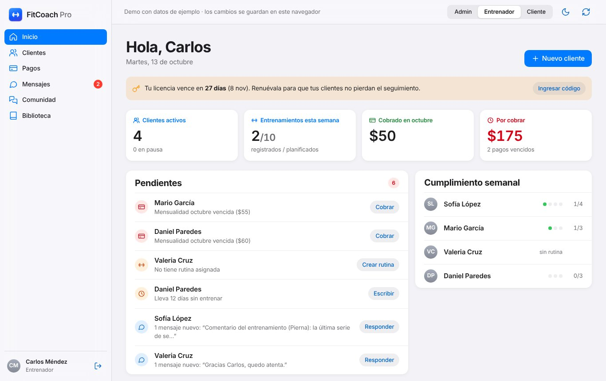
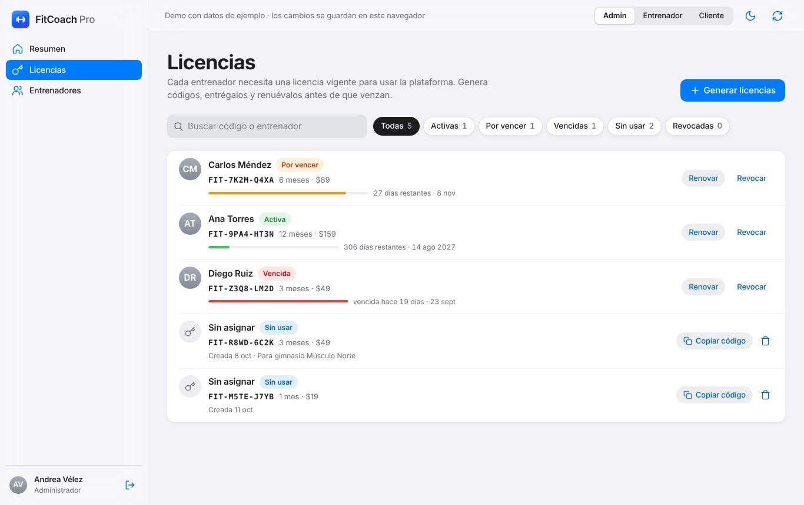
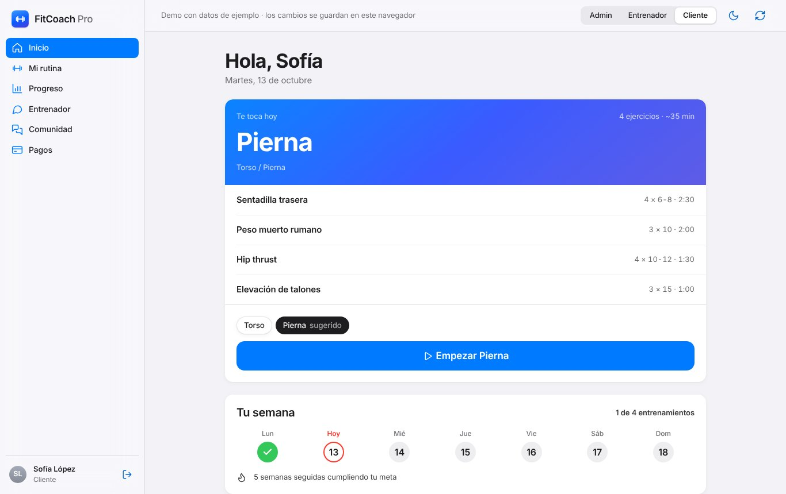

# FitCoach Pro

Plataforma para entrenadores personales con modelo de licencias. Funciona en PC y en el celular (se puede instalar como app).

**Demo interactiva:** [anderssont-var.github.io/AnderssonT-var.github/demos/fitcoach/](https://anderssont-var.github.io/AnderssonT-var.github/demos/fitcoach/)

## Capturas

**Entrenador: pendientes, cumplimiento semanal y cobros**



**Administrador: licencias**



**Cliente: entrenamiento del día**



## Roles

- **Administrador:** genera códigos de licencia (1, 3, 6 o 12 meses), los renueva o revoca, y ve a cada entrenador con sus clientes e ingresos por licencias.
- **Entrenador:** activa su cuenta con un código de licencia. Gestiona clientes, arma rutinas por días, controla mensualidades, chatea con sus clientes y anima a su comunidad. Si la licencia vence o se revoca, el panel se bloquea hasta canjear un código nuevo (sus datos se conservan).
- **Cliente:** ve su rutina, entrena en modo en vivo desde el celular, registra su peso, ve su progreso y sus pagos, y habla con su entrenador.

## Biblioteca de ejercicios

Cada entrenador empieza con **119 ejercicios precargados**, cada uno con:

- Fotos de la posición inicial y final (se animan en la ficha).
- Mapa muscular de frente y espalda con los músculos principales y secundarios resaltados.
- Pasos de ejecución, un consejo técnico y series/reps/descanso sugeridos que se usan al agregarlo a una rutina.

Se filtran por **categoría** (pecho, espalda, hombros, bíceps, tríceps, antebrazos, abdomen, glúteos, cuádriceps, isquiotibiales, pantorrillas, cuerpo completo, cardio y estiramiento), por **equipo** y por **nivel**, con búsqueda por nombre o músculo. El entrenador puede crear los suyos con su propia imagen y músculos.

Imágenes y datos base: [Free Exercise DB](https://github.com/yuhonas/free-exercise-db) (dominio público, Unlicense). Nombres, pasos y consejos traducidos y adaptados al español. Las imágenes están en `public/ejercicios/`.

## Mapa muscular

Siluetas anatómicas de frente y espalda, de hombre o de mujer (cada cliente elige la suya en su perfil). Se usa en:

- **Ficha del ejercicio:** músculos principales y secundarios; toca un músculo para ver su nombre.
- **Biblioteca y selector de rutinas:** botón *Por músculo*: toca un músculo en el cuerpo y solo aparecen los ejercicios que lo trabajan.
- **Crear ejercicio:** se marcan los músculos tocando el cuerpo (un toque principal, dos secundario, tres quita).
- **Progreso del cliente (cliente y entrenador):** mapa de calor de series por semana por músculo en 7 o 30 días, barras con el rango de 10–20 series y la lista de músculos sin trabajar.
- **Editor de rutinas:** balance muscular de las series semanales que plantea la rutina, antes de guardarla.
- **Al terminar un entrenamiento:** mapa de los músculos trabajados ese día.

Trazos de las siluetas basados en [react-native-body-highlighter](https://github.com/HichamELBSI/react-native-body-highlighter) © 2022 ELABBASSI Hicham, licencia MIT (`src/ui/bodyPaths.js`).

## Marca propia de cada entrenador

Cada entrenador personaliza su cuenta sin afectar a los demás:

- **Perfil:** foto, especialidad, años de experiencia, presentación, especialidades, certificaciones y lo que incluye su plan. Sus asesorados lo ven en su app.
- **Marca:** logo, nombre comercial, frase de bienvenida y color. La app de sus asesorados se pinta con ese color y muestra su logo.
- **Acceso propio:** cada entrenador tiene su enlace (por ejemplo `#mendez-strength` o `#torres-fit`). Ese login muestra su logo y su nombre, y solo deja entrar a él y a sus asesorados; una cuenta de otro entrenador recibe un aviso.

Los asesorados también tienen su perfil: foto, “Sobre mí” y lesiones o molestias que su entrenador debe conocer.

## Seguimiento de cada asesorado

En la ficha de cada cliente, el entrenador tiene:

- **Medidas:** peso, % de grasa, cintura, cadera, pecho, brazo y muslo, con gráfico de evolución.
- **Fotos de progreso:** subida de varias fotos (frente, perfil, espalda), galería por fecha y comparación antes/después. El cliente también puede subir las suyas.
- **Notas privadas:** por categoría (técnica, lesión, nutrición, pagos), fijables arriba. El cliente no las ve.

## Funciones principales

| Área | Qué hace |
|---|---|
| Licencias | Códigos `FIT-XXXX-XXXX`, activación en el registro, días restantes, aviso de vencimiento, renovación que suma tiempo, revocación y reactivación |
| Clientes | Alta con acceso temporal, filtros (sin rutina, pago vencido, inactivos), ficha con resumen, rutina, historial, pagos y datos |
| Rutinas | Varios días por rutina, ejercicios con series, reps, descanso y notas, orden, plantillas reutilizables |
| Entrenamiento en vivo | Serie por serie con la carga anterior, discos por lado de la barra, temporizador de descanso con vibración y sonido, sesión que se reanuda, dificultad percibida, récords y mensaje al entrenador |
| Pagos | Mensualidades automáticas del mes, pendientes y vencidos por fecha, registro con método de pago |
| Comunicación | Mensajes 1 a 1, comunidad con publicaciones, retos, me gusta, comentarios y tabla del mes |
| Progreso | Entrenamientos por semana, volumen, peso corporal y récords personales |

## Diseño

Lenguaje visual estilo Apple: tipografía del sistema (SF Pro en Mac y iPhone, Inter en el resto), fondos agrupados, listas con separadores finos, controles segmentados, barras translúcidas y colores de sistema de iOS. Tema claro y oscuro.

## Tecnologías

React 18 · Vite · JavaScript · SQL (esquema en `database/fitcoachpro.sql`)

## Ejecutar en local

```bash
npm install
npm run dev
```

Cuentas de demostración (datos ficticios):

| Rol | Correo | Contraseña |
|---|---|---|
| Admin | admin@fitcoach.com | admin123 |
| Entrenadora (otra marca) | ana@fitcoach.com | coach123 |
| Entrenador | carlos@fitcoach.com | coach123 |
| Cliente | sofia@fitcoach.com | user123 |

En la pantalla de inicio también hay acceso con un toque y, dentro de la app, un selector para cambiar de rol y otro para restablecer los datos.

## Estructura

```
src/
  store/      datos del demo (seed.js) y todas las operaciones (db.js)
  lib/        formatos de fecha, dinero y pesos
  ui/         iconos, componentes base y gráficos
  layout/     barra lateral (PC) y pestañas (móvil)
  pages/      auth · admin · coach · client · shared
  workout/    entrenamiento en vivo, historial y gráficos de progreso
```

## Estado

Prototipo funcional completo del frontend. Los datos se guardan en el navegador (`localStorage`). Cada función de `src/store/db.js` corresponde a un endpoint del backend que falta conectar (autenticación, base de datos y almacenamiento).

---
Desarrollado por [Andersson Toapanta](https://anderssont-var.github.io/AnderssonT-var.github/)
